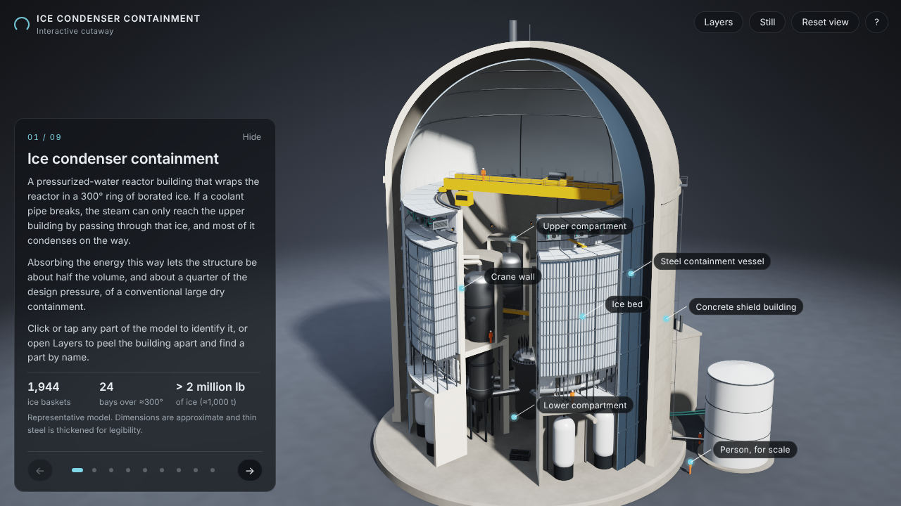
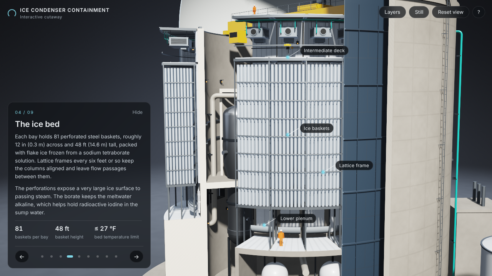
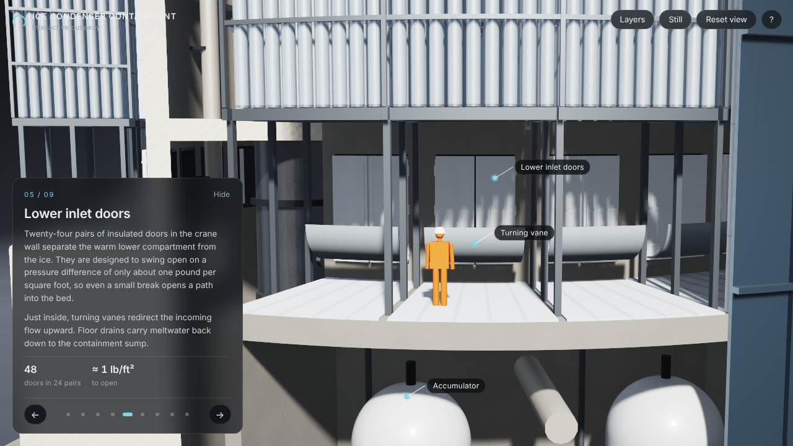
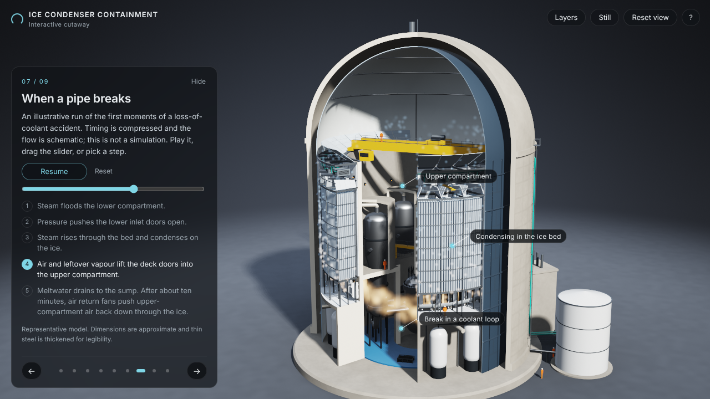

# Ice Condenser Containment — interactive cutaway

An interactive 3D model of a nuclear power plant **ice condenser containment**, built to explain how it works. The ice condenser itself is in the foreground: the ice bed and its baskets, the lower inlet doors, the decks above, and the refrigeration equipment that keeps it frozen. You can orbit it, click any part to find out what it is, peel the building apart layer by layer, and play through what happens when a coolant pipe breaks.



It is plain static files: no build step, no dependencies, no downloaded assets. Every surface is generated from code when the page loads.

## Run it

The page uses JavaScript modules, so it has to be served over http. Opening `index.html` straight from disk shows an explanatory message instead. From this repository's root, any static server works:

```
python -m http.server 8000
```

Then open <http://localhost:8000/>.

It needs a browser with WebGL 2 (current Chrome, Edge, Firefox or Safari). Nothing is fetched from the network at run time.

## What you can do

### Take the tour

Nine stops fly the camera to authored views, each with a short explanation and labelled callouts: the overview, the two compartments, the reactor coolant system, the ice bed, the lower inlet doors, the decks and refrigeration, the pipe-break sequence, long-term cooling, and the trade-offs of the design.

| | |
| --- | --- |
|  |  |
| Where the steam would come from: reactor vessel, steam generators, pumps. | The ice bed: 81 baskets to a bay, held in line by lattice frames. |
|  |  |
| Lower inlet doors and turning vanes. The figure is 1.8 m tall. | The upper plenum: air handling units, glycol headers, the bridge crane. |

### Play the pipe-break sequence

An illustrative run of the first moments of a loss-of-coolant accident. Steam floods the lower compartment, pushes the lower inlet doors open, rises through the ice and condenses, and what is left lifts the deck doors into the upper compartment. Meltwater pools on the floor below as it runs.

You can play and pause it, drag the slider to any moment, or click a step to jump there. Pausing gives a still that is refined like any other.



### Watch long-term cooling

The stop after the sequence has its own moving view: spray falling from the ring headers under the dome, and the air return path that takes upper-compartment air down through the fans, round the lower compartment, and back up through the ice.


Both animations are schematic. Particles follow authored paths with compressed timing; nothing is simulated.

### Identify any part

Click or tap a part, or hover to see its name. The part is highlighted and a panel describes what it is and what it does. There are 45 identifiable parts, from the shield building down to a single hydrogen igniter.


### Peel the layers

**Layers** switches off the shield building, the steel vessel, the interior concrete, the ice baskets, the ice condenser structure, the polar crane or the outdoor equipment. A hidden layer leaves the picture, the shadows and picking together, so whatever was behind it can be clicked. The same panel lists every part by name.


### Find a part from anywhere

A selected part also shows through whatever is in front of it. Here the reactor vessel is selected and seen from behind the building, through the shield wall. This view also shows the outdoor equipment: the refuelling water storage tank, the glycol chillers with their lines climbing to the ice condenser, the main steam valve rooms, and the platform outside the equipment hatch.


## Controls

| Action | Input |
| --- | --- |
| Orbit | Drag, or arrow keys |
| Zoom | Scroll or pinch, or `+` `-` |
| Pan | Right-drag, Shift-drag, or two fingers |
| Reset camera | `R`, or **Reset view** |
| Identify a part | Click or tap it; `Esc` or **Close** clears it |
| Layers and parts list | **Layers**, or `L` |
| Tour stops | The arrows and dots on the card, or `[` `]` |
| Pipe-break sequence | **Play sequence** / **Pause**, or `Space`; drag the slider; click a step |
| Sprays and air return | The button on the long-term cooling stop, or `Space` there |
| Controls help | `?` button, or `H` |
| Performance readout | `G` |
| Higher-quality still | **Still** (full resolution, 160 accumulated samples while the camera rests) |

The layout adapts to a phone: the card moves to the bottom, callouts are dropped, and a tap selects a part.


## What is in the model

A representative Westinghouse-style ice condenser containment, built as a layered cutaway so each shell steps back to reveal the next.

**Structure**

- Concrete shield building and basemat, with an access ladder and a vent stack.
- Free-standing steel containment vessel with ring and vertical stiffeners and welded plate seams, containment spray headers under the dome, and the risers that feed them.
- Crane wall, divider deck with handrails, refuelling cavity and primary shield wall, cable trays.
- Equipment hatch with its outside platform, and a personnel airlock.

**Ice condenser**

- 20 of the 24 bays (four are removed by the front cut), with 81 perforated baskets in each.
- Lattice frames with radial straps and support columns, the lower support structure, turning vanes, jointed insulated wall panels, the floor slab and its drains.
- 40 lower inlet door leaves in framed openings, intermediate deck doors and top deck blanket panels, all hinged and animated.
- Air handling units in the upper plenum with glycol ring headers and branch lines, and the bridge crane on its circular rails.

**Reactor systems**

- Reactor vessel with closure studs and control rod drive housings.
- Four steam generators in their enclosures, four reactor coolant pumps, hot, cold and crossover legs.
- Pressurizer with surge line, pressurizer relief tank, four cold-leg accumulators.
- Main steam lines (routing simplified), containment sump, two air return fans, hydrogen igniters and recombiners.
- Polar crane with operator's cab, and the refuelling machine over the cavity.

**Outdoors**

- Refuelling water storage tank with its supply line.
- Glycol chiller packages, with supply and return lines climbing the shield building to the plenum.
- Two main steam valve rooms where the rear steam lines leave the building.

**Scale**

- Five figures 1.8 m tall: on the ground, by the tank, on the ice condenser floor, on the operating deck and on the polar crane.

About 401,000 triangles with the baskets at their finest level of detail, and about 252,000 from the overview distance, where each basket is drawn as a five-sided prism.


## Sources (everything is editable text)

There are no binary model or texture assets. The code below is the model source.

| File | Role |
| --- | --- |
| `src/plant.js` | **The model.** Dimensions, materials, the list of identifiable parts, and every piece of geometry. |
| `src/geometry.js` | Mesh builder: lathed profiles with wall thickness and capped section faces, annular sectors, filleted tubes, prisms, cylinders. |
| `src/content.js` | Tour text, figures, camera stops, callouts, part descriptions and layer definitions. |
| `src/flow.js` | Authored particle paths for the pipe-break sequence and the long-term cooling view. |
| `src/shaders.js` | GLSL: PBR shading, procedural concrete, steel plate, panel, perforated-basket and section-hatch surfaces, studio environment, tone mapping. |
| `src/renderer.js` | WebGL 2 renderer: shadow maps, MSAA HDR target, progressive accumulation, layer hiding, part picking, the see-through highlight, GPU timing. |
| `src/main.js` | Loading, camera, input, UI, the frame loop and its performance budget. |
| `src/math.js` | Matrix and vector helpers. |
| `tests/` | Node tests for the model and content. |

To add a part: give it an entry in `PARTS` in `plant.js`, call `part('yourKey')` before modelling it, and add its description to `PART_INFO` in `content.js`. The tests fail if any of the three is missing.

## Rendering, and what it does not claim

- Forward renderer, linear HDR (RGBA16F, 4× MSAA), ACES-fitted tone mapping, sRGB output. It falls back to 8-bit targets if float render targets are unavailable.
- GGX specular and Lambert diffuse with a clearcoat lobe; one shadow-mapped key light, a rim light, and an **analytic** studio environment (softboxes defined in the shader, not an HDR photograph).
- While the camera rests the image accumulates over 40 samples: sub-pixel jitter for anti-aliasing, a jittered key light for soft shadow edges, and four re-drawn "sky" shadow directions per sample that converge to ambient occlusion.
- This is a rasterised approximation, **not** a path tracer. There is no bounced light; interiors use a constant ambient floor and a dim neutral reflection fallback instead.
- A depth pre-pass runs before the main pass, so the costly main shader runs once per visible pixel instead of once for every surface stacked behind it (2.7 to 5.1 times per pixel without it, measured at three tour stops). It is skipped on software rasterizers, which do not benefit.
- Picking draws the scene into a single pixel on demand. The see-through highlight uses the alpha channel as a stencil, so its tint is even however many layers of the part are stacked.

## Which graphics card is used

The page asks the browser for the high-performance GPU, but **on Windows the browser decides, not the page**: Chrome and Edge run on whichever adapter Windows assigns them and ignore the request. On a laptop with both integrated graphics and a dedicated card, that is usually the integrated one.

Press `G` to see which is in use; the last line of the readout names it. To move the browser to the dedicated card:

1. Open Windows Settings, then System, Display, Graphics.
2. Add the browser to the list and set it to **High performance**.
3. Close the browser completely, reopen it and reload the page.

In Chrome or Edge, enabling `force-high-performance-gpu` on the flags page and relaunching does the same.

When the page finds itself on integrated graphics under Windows it shows a notice with these steps until dismissed. It also runs lighter there: 2048-pixel shadow maps instead of 4096, and 2× MSAA instead of 4×. The picture at rest is refined to the same result either way.

## GPU load

The page is built to leave the GPU alone whenever it can:

- **Nothing runs when nothing changes.** Once the picture has converged, no frame callback is scheduled at all. Any input starts the loop again.
- **Frame-rate cap.** Displays up to 100 Hz are drawn every refresh. Faster ones are drawn every second or third refresh: 120 Hz gets 60 frames a second and 144 Hz gets 72.
- **Lower resolution while moving.** A moving frame is limited to about 1.15 million pixels (1.7 million while only an animation is running) and stretched to fit. The full-resolution picture comes back about a tenth of a second after the camera stops. Resolution changes through the viewport, so no buffer is reallocated.
- **GPU-time budget.** Where the browser reports real GPU time (`EXT_disjoint_timer_query_webgl2`, in Chrome and Edge on desktop), moving frames are held to about 6 ms by lowering the resolution further, down to 50%. Elsewhere the same control reacts to late frames instead.
- **Baskets by distance.** A basket is fourteen-sided up close, eight-sided at mid range and five-sided from the overview, where it is two or three pixels wide. They are also back-face culled.
- **Paced refinement.** The refinement samples, each of which redraws five shadow maps, are spread to about 30 a second.
- **Pausing the sequence** stops the frame loop like any other still.
- **Resolution ceiling.** The canvas is limited to about 3.7 million pixels, the equivalent of 2560 × 1440 (8.3 million, or 3840 × 2160, with **Still** on), whatever the display.

These limits are constants at the top of `src/main.js`.

`G` shows frames drawn per second, GPU time per frame where available, render resolution, triangles submitted, an estimate of GPU memory in use, and the GPU's name and tier. To compare the depth pre-pass on and off, run this in the browser console (the page freezes while it runs):

```
__ice.bench()
```

## Tests

```
node --test "tests/*.test.mjs"
```

Needs Node 22 or later and nothing else. The 19 tests build the model and check that every mesh is well formed, every vertex belongs to a described part, culled parts are wound outwards, the triangle budget holds, animation particles stay finite and inside the building, layers name real parts, and the tour copy, the page and the shaders agree with the code. They do not open a browser, so they cannot catch a shader that fails to compile. GitHub Actions runs them on every pull request that touches this folder.

## Accuracy notes

- The model is an illustration, not an engineering model and not any specific plant. Dimensions are approximate, and thin steel (the containment shell, door panels, lattice straps) is thickened so it survives normal viewing distance.
- Some things are placed for visibility rather than fidelity. The main steam lines are routed simply. The glycol chillers are drawn outdoors; the refrigeration plant is outside the containment, but in a building. The figures stand where nobody would with the plant running.
- Figures in the text (1,944 baskets, 24 bays, basket size, door opening pressure, temperatures, pressures, plant list) are typical published values for this design and vary by unit. Treat them as approximate and check a plant's safety analysis report before relying on any of them.
- The pipe-break sequence and the long-term cooling view are authored animations with compressed timing. Nothing in them is simulated.
- It was written without Three.js or Blender (see the first pull request for why), as a dependency-free WebGL 2 renderer.

## About the screenshots

Captured from the running page at 1280 × 720 (the phone layout at 390 × 844) after refinement to 40 samples, with the shadow-map sizes a dedicated GPU gets. They were rendered on a software rasterizer with MSAA off, so their anti-aliasing comes from the 40 samples alone. The long-term cooling view is a moving picture; one instant of it was frozen and refined for the capture.
