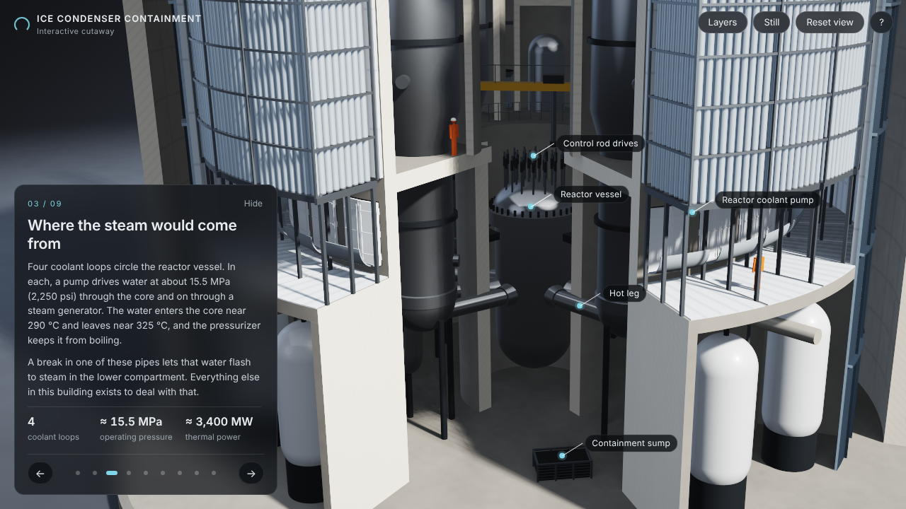
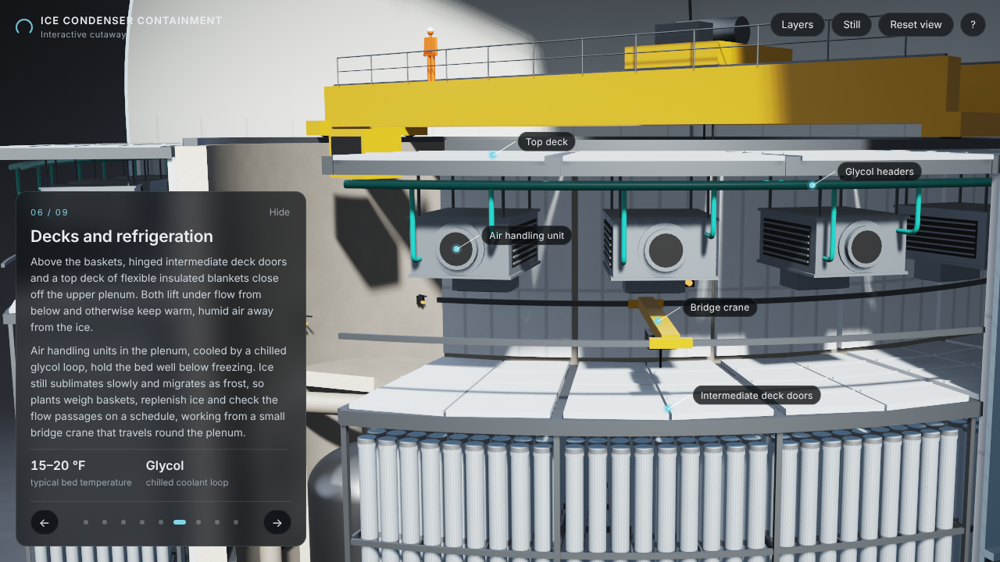
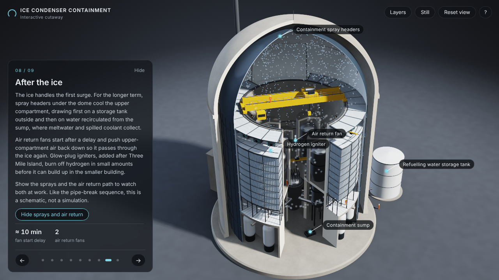
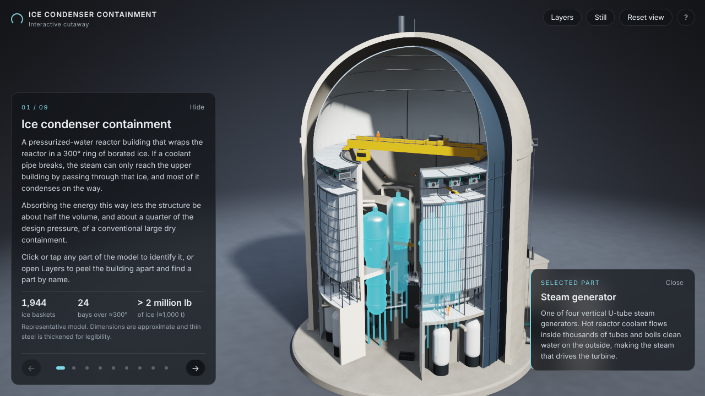
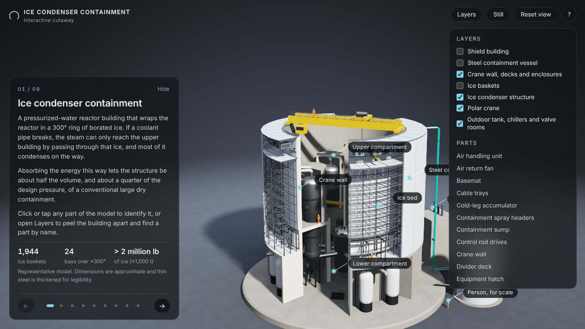
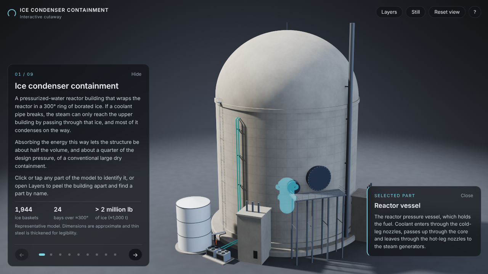
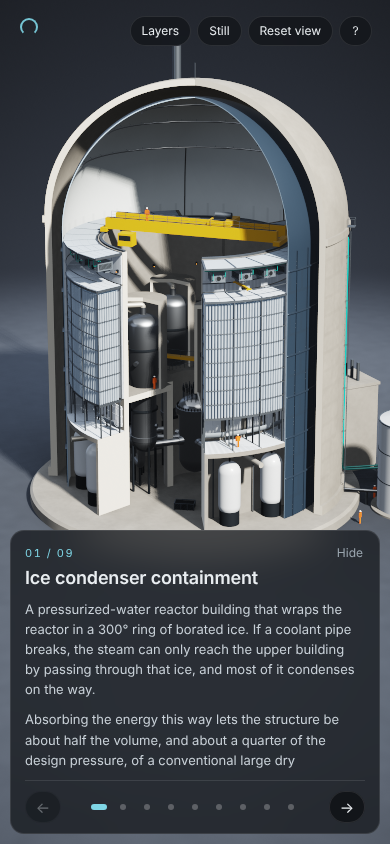
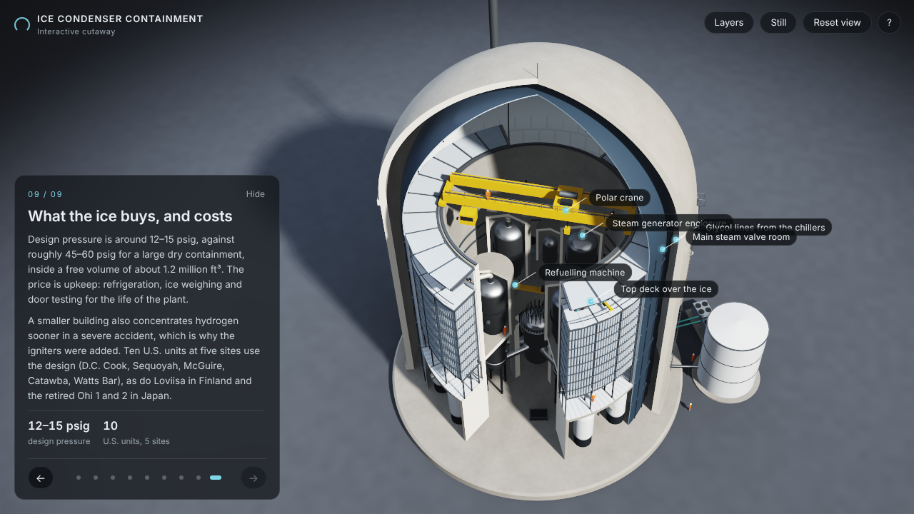

# Ice Condenser Containment — interactive cutaway

**Open it in your browser: <https://dionnedeh.github.io/IC/>**

> **For fun and for education only.** This is not an established or authoritative information source, and it must not be used for engineering, safety, operational or regulatory purposes. Every effort has been made to keep it accurate and to trace its figures to the public documents listed under [References](#references), but it is a simplified, representative model of no specific plant, the figures vary from unit to unit, and it may contain mistakes. Where accuracy matters, go to the sources.

An interactive 3D model of a nuclear power plant **ice condenser containment**, built to explain how it works. The ice condenser itself is in the foreground: the ice bed and its baskets, the lower inlet doors, the decks above, and the refrigeration equipment that keeps it frozen. You can orbit it, click any part to find out what it is, peel the building apart layer by layer, and play through what happens when a coolant pipe breaks.


It is plain static files: no build step, no dependencies, no downloaded assets. Every surface is generated from code when the page loads.

## Run it

The quickest way is the hosted copy at <https://dionnedeh.github.io/IC/>, which GitHub Pages serves from the `main` branch of this repository. To run your own copy:

The page uses JavaScript modules, so it has to be served over http. Opening `index.html` straight from disk shows an explanatory message instead. From this repository's root, any static server works:

```
python -m http.server 8000
```

Then open <http://localhost:8000/>.

It needs a browser with WebGL 2 (current Chrome, Edge, Firefox or Safari). Nothing is fetched from the network at run time; the reference links leave the page only when you click one.

### Check the sources

Every time the page is opened it first shows the advisory above on a card, which has to be dismissed before the model can be used. It is not remembered, so it comes back on the next visit.

**Sources**, or `S`, opens a panel with the advisory above and every reference the text draws on. Each tour stop also links the documents it leans on most.

## What you can do

### Take the tour

Nine stops fly the camera to authored views, each with a short explanation and labelled callouts: the overview, the two compartments, the reactor coolant system, the ice bed, the lower inlet doors, the decks and refrigeration, the pipe-break sequence, long-term cooling, and the trade-offs of the design.

| | |
| --- | --- |
|  |  |
| Where the steam would come from: reactor vessel, steam generators, pumps. | The ice bed: 81 baskets to a bay, held in line by lattice frames. |
|  |  |
| Lower inlet doors and turning vanes. The figure is 1.8 m tall. | The upper plenum: air handling units, glycol headers, the bridge crane. |

### Play the pipe-break sequence

An illustrative run of the first moments of a loss-of-coolant accident. Steam floods the lower compartment, pushes the lower inlet doors open, rises through the ice and condenses, and what is left lifts the deck doors into the upper compartment. Meltwater pools on the floor below as it runs.

You can play and pause it, drag the slider to any moment, or click a step to jump there. Pausing gives a still that is refined like any other.


### Watch long-term cooling

The stop after the sequence has its own moving view: spray falling from the ring headers under the dome, and the air return path that takes upper-compartment air down through the fans, round the lower compartment, and back up through the ice.



Both animations are schematic. Particles follow authored paths with compressed timing; nothing is simulated.

### Identify any part

Click or tap a part, or hover to see its name. The part is highlighted and a panel describes what it is and what it does. There are 45 identifiable parts, from the shield building down to a single hydrogen igniter.



### Peel the layers

**Layers** switches off the shield building, the steel vessel, the interior concrete, the ice baskets, the ice condenser structure, the polar crane or the outdoor equipment. A hidden layer leaves the picture, the shadows and picking together, so whatever was behind it can be clicked. The same panel lists every part by name.



### Find a part from anywhere

A selected part also shows through whatever is in front of it. Here the reactor vessel is selected and seen from behind the building, through the shield wall. This view also shows the outdoor equipment: the refuelling water storage tank, the glycol chillers with their lines climbing to the ice condenser, the main steam valve rooms, and the platform outside the equipment hatch.



## Controls

| Action | Input |
| --- | --- |
| Orbit | Drag, or arrow keys |
| Zoom | Scroll or pinch, or `+` `-` |
| Pan | Right-drag, Shift-drag, or two fingers |
| Reset camera | `R`, or **Reset view** |
| Identify a part | Click or tap it; `Esc` or **Close** clears it |
| Layers and parts list | **Layers**, or `L` |
| Sources and advisory | **Sources**, or `S` |
| Tour stops | The arrows and dots on the card, or `[` `]` |
| Pipe-break sequence | **Play sequence** / **Pause**, or `Space`; drag the slider; click a step |
| Sprays and air return | The button on the long-term cooling stop, or `Space` there |
| Controls help | `?` button, or `H` |
| Performance readout | `G` |
| Higher-quality still | **Still** (full resolution, 160 accumulated samples while the camera rests) |

The layout adapts to a phone: the card moves to the bottom, callouts are dropped, and a tap selects a part.



## What is in the model

A representative Westinghouse-style ice condenser containment, built as a layered cutaway so each shell steps back to reveal the next.

**Structure**

- Concrete shield building and basemat, with an access ladder and a vent stack.
- Free-standing steel containment vessel with ring and vertical stiffeners and welded plate seams, containment spray headers under the dome, and the risers that feed them.
- Crane wall, divider deck with handrails, refuelling cavity and primary shield wall, cable trays.
- Equipment hatch with its outside platform, and a personnel airlock.

**Ice condenser**

- 20 of the 24 bays (four are removed by the front cut), with 81 perforated baskets in each.
- Lattice frames with radial straps and support columns, the lower support structure, turning vanes, jointed insulated wall panels, the floor slab and its drains.
- 40 lower inlet door leaves in framed openings, intermediate deck doors and top deck blanket panels, all hinged and animated.
- Air handling units in the upper plenum with glycol ring headers and branch lines, and the bridge crane on its circular rails.

**Reactor systems**

- Reactor vessel with closure studs and control rod drive housings.
- Four steam generators in their enclosures, four reactor coolant pumps, hot, cold and crossover legs.
- Pressurizer with surge line, pressurizer relief tank, four cold-leg accumulators.
- Main steam lines (routing simplified), containment sump, two air return fans, hydrogen igniters and recombiners.
- Polar crane with operator's cab, and the refuelling machine over the cavity.

**Outdoors**

- Refuelling water storage tank with its supply line.
- Glycol chiller packages, with supply and return lines climbing the shield building to the plenum.
- Two main steam valve rooms where the rear steam lines leave the building.

**Scale**

- Five figures 1.8 m tall: on the ground, by the tank, on the ice condenser floor, on the operating deck and on the polar crane.

About 401,000 triangles with the baskets at their finest level of detail, and about 252,000 from the overview distance, where each basket is drawn as a five-sided prism.



## Source files (everything is editable text)

There are no binary model or texture assets. The code below is the model source.

| File | Role |
| --- | --- |
| `src/plant.js` | **The model.** Dimensions, materials, the list of identifiable parts, and every piece of geometry. |
| `src/geometry.js` | Mesh builder: lathed profiles with wall thickness and capped section faces, annular sectors, filleted tubes, prisms, cylinders. |
| `src/content.js` | Tour text, figures, camera stops, callouts, part descriptions, layer definitions, the reference list and the advisory. |
| `src/flow.js` | Authored particle paths for the pipe-break sequence and the long-term cooling view. |
| `src/shaders.js` | GLSL: PBR shading, procedural concrete, steel plate, panel, perforated-basket and section-hatch surfaces, studio environment, tone mapping. |
| `src/renderer.js` | WebGL 2 renderer: shadow maps, MSAA HDR target, progressive accumulation, layer hiding, part picking, the see-through highlight, GPU timing. |
| `src/main.js` | Loading, camera, input, UI, the frame loop and its performance budget. |
| `src/math.js` | Matrix and vector helpers. |
| `tests/` | Node tests for the model and content. |

To add a part: give it an entry in `PARTS` in `plant.js`, call `part('yourKey')` before modelling it, and add its description to `PART_INFO` in `content.js`. The tests fail if any of the three is missing.

## Rendering, and what it does not claim

- Forward renderer, linear HDR (RGBA16F, 4× MSAA), ACES-fitted tone mapping, sRGB output. It falls back to 8-bit targets if float render targets are unavailable.
- GGX specular and Lambert diffuse with a clearcoat lobe; one shadow-mapped key light, a rim light, and an **analytic** studio environment (softboxes defined in the shader, not an HDR photograph).
- While the camera rests the image accumulates over 40 samples: sub-pixel jitter for anti-aliasing, a jittered key light for soft shadow edges, and four re-drawn "sky" shadow directions per sample that converge to ambient occlusion.
- This is a rasterised approximation, **not** a path tracer. There is no bounced light; interiors use a constant ambient floor and a dim neutral reflection fallback instead.
- A depth pre-pass runs before the main pass, so the costly main shader runs once per visible pixel instead of once for every surface stacked behind it (2.7 to 5.1 times per pixel without it, measured at three tour stops). It is skipped on software rasterizers, which do not benefit.
- Picking draws the scene into a single pixel on demand. The see-through highlight uses the alpha channel as a stencil, so its tint is even however many layers of the part are stacked.

## Which graphics card is used

The page asks the browser for the high-performance GPU, but **on Windows the browser decides, not the page**: Chrome and Edge run on whichever adapter Windows assigns them and ignore the request. On a laptop with both integrated graphics and a dedicated card, that is usually the integrated one.

Press `G` to see which is in use; the last line of the readout names it. To move the browser to the dedicated card:

1. Open Windows Settings, then System, Display, Graphics.
2. Add the browser to the list and set it to **High performance**.
3. Close the browser completely, reopen it and reload the page.

In Chrome or Edge, enabling `force-high-performance-gpu` on the flags page and relaunching does the same.

When the page finds itself on integrated graphics under Windows it shows a notice with these steps until dismissed. It also runs lighter there: 2048-pixel shadow maps instead of 4096, and 2× MSAA instead of 4×. The picture at rest is refined to the same result either way.

## GPU load

The page is built to leave the GPU alone whenever it can:

- **Nothing runs when nothing changes.** Once the picture has converged, no frame callback is scheduled at all. Any input starts the loop again.
- **Frame-rate cap.** Displays up to 100 Hz are drawn every refresh. Faster ones are drawn every second or third refresh: 120 Hz gets 60 frames a second and 144 Hz gets 72.
- **Lower resolution while moving.** A moving frame is limited to about 1.15 million pixels (1.7 million while only an animation is running) and stretched to fit. The full-resolution picture comes back about a tenth of a second after the camera stops. Resolution changes through the viewport, so no buffer is reallocated.
- **GPU-time budget.** Where the browser reports real GPU time (`EXT_disjoint_timer_query_webgl2`, in Chrome and Edge on desktop), moving frames are held to about 6 ms by lowering the resolution further, down to 50%. Elsewhere the same control reacts to late frames instead.
- **Baskets by distance.** A basket is fourteen-sided up close, eight-sided at mid range and five-sided from the overview, where it is two or three pixels wide. They are also back-face culled.
- **Paced refinement.** The refinement samples, each of which redraws five shadow maps, are spread to about 30 a second.
- **Pausing the sequence** stops the frame loop like any other still.
- **Resolution ceiling.** The canvas is limited to about 3.7 million pixels, the equivalent of 2560 × 1440 (8.3 million, or 3840 × 2160, with **Still** on), whatever the display.

These limits are constants at the top of `src/main.js`.

`G` shows frames drawn per second, GPU time per frame where available, render resolution, triangles submitted, an estimate of GPU memory in use, and the GPU's name and tier. To compare the depth pre-pass on and off, run this in the browser console (the page freezes while it runs):

```
__ice.bench()
```

## Tests

```
node --test "tests/*.test.mjs"
```

Needs Node 22 or later and nothing else. The 20 tests build the model and check that every mesh is well formed, every vertex belongs to a described part, culled parts are wound outwards, the triangle budget holds, animation particles stay finite and inside the building, layers name real parts, every tour stop cites references that this README also links, and the tour copy, the page and the shaders agree with the code. They do not open a browser, so they cannot catch a shader that fails to compile, and they do not check that the reference links still resolve. GitHub Actions runs them on every pull request that touches the model, the page or the tests.

## Accuracy notes

- The model is an illustration, not an engineering model and not any specific plant. Dimensions are approximate, and thin steel (the containment shell, door panels, lattice straps) is thickened so it survives normal viewing distance.
- Some things are placed for visibility rather than fidelity. The main steam lines are routed simply. The glycol chillers are drawn outdoors; the refrigeration plant is outside the containment, but in a building. The figures stand where nobody would with the plant running.
- The model follows the steel-shell plants (Sequoyah, Watts Bar, McGuire, Catawba): a free-standing steel vessel inside a concrete shield building, with an annulus between. D.C. Cook is different: one steel-lined reinforced concrete containment, with no separate shell and no annulus.
- Figures in the text come from the documents under [References](#references). They vary by unit and by licence amendment, and the ones quoted may since have been superseded. Treat them as approximate and check a plant's current safety analysis report and technical specifications before relying on any of them.
- The pipe-break sequence and the long-term cooling view are authored animations with compressed timing. Nothing in them is simulated.
- It was written without Three.js or Blender, as a dependency-free WebGL 2 renderer.

### Where the plants differ

The text gives ranges where the plants disagree. These are the values found in the references:

| | D.C. Cook | Sequoyah | Watts Bar | McGuire | Catawba |
| --- | --- | --- | --- | --- | --- |
| Containment design pressure | 12 psig | 10.8 psig | 13.5 psig | 15 psig | 15 psig |
| Minimum ice required | 2,200,000 lb | about 2.2 million lb (it has changed between amendments) | 2,404,500 lb (Unit 2) | 1,890,000 lb | 2,132,000 lb |
| Ice bed temperature limit | 27 °F | 27 °F | 27 °F | 27 °F | 27 °F |
| Air return fan start delay | 270 to 300 s | 10 ± 1 min | 8 to 10 min | 9 ± 1 min | 9 ± 1 min |

Common to all: 1,944 baskets in 24 bays over a 300° arc, 24 pairs of lower inlet doors, and two air return fans or fan trains.

### What was checked, and what was not

The tour text and part descriptions were checked against the references in November 2026, and several figures were corrected as a result: the design pressure range (it was given as 12 to 15 psig, which left out Sequoyah), the ice mass (given as "more than 2 million lb", which is not true of McGuire's minimum), the typical bed temperature, the fan start delay (D.C. Cook's is about five minutes, not ten), and the size comparison with a large dry containment.

Some things could not be confirmed from a document that was opened, and the text was changed so that it no longer leans on them:

- The thickness of the concrete shield building wall. An earlier version said "about a metre"; the figure has been removed.
- That igniters are "glow plugs". The references call them thermal igniters, so the text now does too.
- 81 baskets to a bay is 1,944 divided by 24 with nine radial rows, and is stated outright only in trade press, not in a regulatory document that was opened.
- Loviisa and Ohi rest on the operator's own history page and on news reporting respectively, not on a regulator's document.
- The typical operating bed temperature is from the Cook and McGuire reports only.

If you find an error, please open an issue.

## References

Public documents the text draws on, in the order the page lists them. The note after each says what it was used for. Most are large PDFs on the U.S. Nuclear Regulatory Commission's site, which can be slow and sometimes refuses automated requests; they open in a browser.

1. [D.C. Cook Updated Final Safety Analysis Report, Chapter 5, "Containment System" (Rev. 30)](https://www.nrc.gov/docs/ML2112/ML21125A562.pdf). Indiana Michigan Power, in NRC ADAMS, ML21125A562. *Ice bed, doors, decks, refrigeration, divider barrier; the steel-lined concrete containment; 12 psig design pressure.*
2. [McGuire Updated Final Safety Analysis Report, Chapter 6, "Engineered Safety Features" (2020)](https://www.nrc.gov/docs/ML2030/ML20309A729.pdf). Duke Energy, in NRC ADAMS, ML20309A729. *Baskets, lattice frames, lower inlet doors, turning vanes, deck doors, air handling units and glycol loop; 15 psig; free volume; fan delay.*
3. [Catawba Updated Final Safety Analysis Report, Chapter 6 (2018)](https://www.nrc.gov/docs/ML1830/ML18305A298.pdf). Duke Energy, in NRC ADAMS, ML18305A298. *Section 6.7 describes the ice condenser; 15 psig design pressure; free volume; fan delay.*
4. [TSTF-336 Rev. 1, reproducing the NUREG-1431 Standard Technical Specifications and Bases for the ice bed and its doors](https://www.nrc.gov/docs/ML0037/ML003735321.pdf). Technical Specifications Task Force, in NRC ADAMS, ML003735321. *1,944 baskets, 24 bays, 300° arc, 27 °F limit, boron and pH, sublimation and frost, flow channel checks, door opening order.*
5. [Watts Bar Unit 2 Technical Specifications (developmental revision, 2013)](https://www.nrc.gov/docs/ML1335/ML13357A053.pdf). Tennessee Valley Authority, in NRC ADAMS, ML13357A053. *Minimum ice mass, 27 °F limit, air return fan delay of 8 to 10 minutes.*
6. [McGuire Technical Specification 3.6.12, "Ice Bed", and Bases (Amendments 217/199)](https://www.nrc.gov/docs/ML0327/ML032760444.pdf). NRC ADAMS, ML032760444. *Minimum ice mass of 1,890,000 lb, the lowest of the plants checked.*
7. [D.C. Cook Unit 1 Technical Specifications Bases](https://www.nrc.gov/docs/ML1635/ML16355A102.pdf). Indiana Michigan Power, in NRC ADAMS, ML16355A102. *Minimum ice mass; recirculation fans that start after 270 to 300 seconds.*
8. [Sequoyah Improved Technical Specifications Conversion, Enclosure 2, Volume 11 (Section 3.6, Containment Systems)](https://www.nrc.gov/docs/ML1333/ML13330A931.pdf). Tennessee Valley Authority, in NRC ADAMS, ML13330A931. *Ice bed limits, air return fan delay, and the emergency gas treatment system that holds the annulus below atmospheric pressure.*
9. [NUREG-0011 Supplement 3, Safety Evaluation Report for Sequoyah Nuclear Plant (1980)](https://www.osti.gov/etdeweb/servlets/purl/20472055). U.S. Nuclear Regulatory Commission, hosted by OSTI. *Sequoyah design pressure of 10.8 psig and its free volume.*
10. [NUREG-1150, "Severe Accident Risks: An Assessment for Five U.S. Nuclear Power Plants", Volume 2, Appendix C](https://www.nrc.gov/reading-rm/doc-collections/nuregs/staff/sr1150/v2/sr1150v2appc.pdf). U.S. Nuclear Regulatory Commission, 1990. *Side-by-side free volume and design pressure for Sequoyah (ice condenser), Zion and Surry (dry); hydrogen after Three Mile Island.*
11. [NUREG/CR-6906, "Containment Integrity Research at Sandia National Laboratories: An Overview"](https://www.sandia.gov/app/uploads/sites/172/2022/03/NUREG_CR-6906-ContSum.pdf). Sandia National Laboratories for the U.S. NRC, 2006. *A short, readable account of the containment types, with a figure of an ice condenser containment.*
12. [NRC Information Notice 89-79, "Degraded Coatings and Corrosion of Steel Containment Vessels"](https://www.nrc.gov/docs/ML0311/ML031190084.pdf). U.S. Nuclear Regulatory Commission, in ADAMS, ML031190084. *Steel shell about one inch thick and a six-foot annulus at McGuire and Catawba.*
13. [NUREG-0933, Item B-54, "Ice Condenser Containments"](https://www.nrc.gov/sr0933/section-2-task-action-plan-items/item-b-54-ice-condenser-containments). U.S. Nuclear Regulatory Commission. *The regulator's own short summary of the design.*
14. [NUREG-0933, Issue 189, susceptibility of ice condenser and Mark III containments to early failure from hydrogen combustion](https://www.nrc.gov/sr0933/section-3-new-generic-issues/issue-189-susceptibility-ice-condenser-containments-early-failure-hydogen-combustion-during-severe). U.S. Nuclear Regulatory Commission. *Why a small, low-pressure containment is more exposed to hydrogen burns.*
15. [McGuire Technical Specification Bases, including B 3.6.9 "Hydrogen Mitigation System" and B 3.6.16 "Reactor Building"](https://www.nrc.gov/docs/ML1414/ML14142A011.pdf). Duke Energy, in NRC ADAMS, ML14142A011. *Thermal igniters and why ice condenser units need them; the annulus ventilation system.*
16. ["Combustible Gas Control in Containment", final rule, 68 FR 54123 (16 September 2003)](https://www.govinfo.gov/content/pkg/FR-2003-09-16/html/03-23554.htm). U.S. Nuclear Regulatory Commission, via GovInfo. *Removed the requirement for hydrogen recombiners; kept hydrogen control for ice condenser and Mark III containments.*
17. [10 CFR 50.44, "Combustible gas control for nuclear power reactors"](https://www.law.cornell.edu/cfr/text/10/50.44). Code of Federal Regulations, via Cornell Legal Information Institute. *The rule as it stands.*
18. [Westinghouse Technology Systems Manual, Section 3.2, "Reactor Coolant System"](https://www.nrc.gov/docs/ML1122/ML11223A213.pdf). U.S. NRC Technical Training Center, in ADAMS, ML11223A213. *Loop layout, steam generators, pumps, pressurizer, surge line and relief tank.*
19. [Catawba Updated Final Safety Analysis Report, Appendix 4A, Table 4-1, "Reactor Design Comparison Table"](https://www.nrc.gov/docs/ML1830/ML18305A292.pdf). Duke Energy, in NRC ADAMS, ML18305A292. *3,411 MW thermal, 2,250 psia, 554.7 °F inlet and a 62.5 °F rise through the vessel.*
20. [Westinghouse Technology Systems Manual, Section 5.2, "Emergency Core Cooling Systems"](https://www.nrc.gov/docs/ML1122/ML11223A220.pdf). U.S. NRC Technical Training Center, in ADAMS, ML11223A220. *Accumulators, the refuelling water storage tank, and the switch to recirculation from the sump.*
21. [Westinghouse Technology Systems Manual, Section 5.3, "Containment"](https://www.nrc.gov/docs/ML1122/ML11223A221.pdf). U.S. NRC Technical Training Center, in ADAMS, ML11223A221. *The large dry containment used for comparison: about 2 million ft³ and 60 psig.*
22. [Westinghouse Technology Systems Manual, Section 5.4, "Containment Temperature, Pressure and Combustible Gas Control Systems"](https://www.nrc.gov/docs/ML1122/ML11223A222.pdf). U.S. NRC Technical Training Center, in ADAMS, ML11223A222. *Containment spray, from the storage tank and then from the sump.*
23. [Westinghouse Technology Systems Manual, index of all chapters](https://www.nrc.gov/docs/ML1122/ML11221A368.html). U.S. NRC Technical Training Center, in ADAMS, ML11221A368. *Sections 3.1 (reactor vessel, control rod drop) and 17.1 (fuel handling, the flooded refuelling cavity) were also used.*
24. [Reactor Concepts Manual, "Pressurized Water Reactor (PWR) Systems"](https://www.nrc.gov/reading-rm/basic-ref/students/for-educators/04.pdf). U.S. NRC Technical Training Center. *The most readable starting point for how a pressurized-water reactor works.*
25. [List of Power Reactor Units](https://www.nrc.gov/reactors/operating/list-power-reactor-units.html). U.S. Nuclear Regulatory Commission. *The ten operating U.S. units; each unit's page gives its containment type as "Wet, Ice condenser".*
26. [Loviisa power plant history](https://www.fortum.com/energy-production/nuclear-power/plants/loviisa/history). Fortum. *Two VVER-440 units whose steel containment and ice condensers were built under Westinghouse licences.*
27. ["Kansai opts to retire older Ohi units"](https://world-nuclear-news.org/articles/kansai-opts-to-retire-older-ohi-units). World Nuclear News, 22 December 2017. *Japan's only ice condenser reactors, and the decision to retire them. News reporting, not a primary document.*

Further reading, not used for any figure: ["Maintaining Nuclear Plant Ice Condensers: A Cool Responsibility"](https://www.powermag.com/maintaining-nuclear-plant-ice-condensers-a-cool-responsibility/), POWER Magazine, an accessible trade-press account of the upkeep at Watts Bar.

## About the screenshots

The screenshots predate the **Sources** button, so the toolbar in them has four buttons instead of five.

Captured from the running page at 1280 × 720 (the phone layout at 390 × 844) after refinement to 40 samples, with the shadow-map sizes a dedicated GPU gets. They were rendered on a software rasterizer with MSAA off, so their anti-aliasing comes from the 40 samples alone. The long-term cooling view is a moving picture; one instant of it was frozen and refined for the capture.
